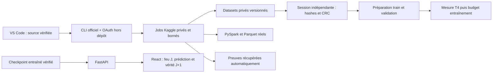

# Orchestration du suivi 3

Le CLI officiel Kaggle 2.2.5 est isolé dans `artifacts/orchestrator/kaggle-cli-env`.
La connexion OAuth est enregistrée par le SDK dans le profil Windows, hors du
dépôt. Aucun notebook ne contient de jeton. Le lanceur de connexion supprime les
logs HTTP du callback OAuth, qui pourraient autrement exposer son code.

## Commandes locales

Depuis la racine du projet :

```powershell
.\.venv\Scripts\python.exe scripts\kaggle_orchestrate.py status
.\.venv\Scripts\python.exe scripts\serve_demo.py
```

La seconde commande sert React et FastAPI sur `http://127.0.0.1:8000`. Le frontend
est compilé avec `npm.cmd run build` depuis `frontend`. Ses dépendances sont
épinglées dans `frontend/package-lock.json`. Le lancement utilise le snapshot et
l'identité de confiance enregistrés dans `artifacts/demo-serving/local.json`.
Pour reconstruire les outils isolés, utiliser `scripts/setup_kaggle_cli.ps1`,
puis le Python de cet environnement pour `scripts/kaggle_secure_login.py` si
la connexion OAuth est absente.

L'orchestrateur expose `prepare`, `submit`, `refresh`, `watch` et `fetch`. Chaque
job possède un identifiant, une source embarquée avec hashes, des métadonnées
Kaggle privées et un journal append-only. Les commandes `submit` et `fetch`
n'ont besoin d'aucun fichier copié depuis un navigateur. `watch` attend au plus
55 secondes puis rend la main. Les preuves sont récupérées dans de nouveaux
dossiers `retrievals/<uuid>` ; aucune preuve ancienne n'est remplacée.

Une seconde tentative de soumission du même job est refusée : après un timeout,
il faut lire son état plutôt que créer un doublon. Les transferts et sondes GPU
nécessitent un enregistrement local de l'autorisation utilisateur lié à
l'identité exacte du job. Les acquisitions 2018 et 2020 ont reçu cette
autorisation le 31 octobre ; l'extension 2019 et les campagnes GPU longues
restent hors de cette autorisation.

## Supervision contrôlable

`scripts/kaggle_supervise.py --jobs <identifiants> --minutes 65` surveille et
récupère les preuves. Il ne soumet jamais de job. Son PID, son échéance, ses
cycles horodatés et sa fin sont conservés sous `artifacts/orchestrator/monitor-*`.
Le champ `last_remote_check` du statut indique la fraîcheur du dernier appel
Kaggle ; une ancienne lecture n'est jamais présentée comme un état instantané.

Créer un fichier `stop.request` dans le dossier du moniteur arrête sa prochaine
boucle. Cela arrête la surveillance locale ; les jobs Kaggle conservent leurs
limites serveur : 15 minutes pour la certification, 15 minutes pour la reprise
Spark et 60 minutes pour chacun des deux transferts autorisés. Les logs et les
résultats d'échec sont conservés.

La chaîne autonome `scripts/kaggle_chain.py` poursuit les deux acquisitions
déjà soumises : récupération des preuves, récupération en lecture seule d'une
publication existante si nécessaire, certification dans de nouvelles sessions,
puis sonde de débit T4 demandée par l'utilisateur. Elle ne relance jamais Zenodo
et ne démarre aucun entraînement GPU de plusieurs epochs. Les identifiants de
ses jobs enfants sont enregistrés avant soumission, permettant une reprise
sans doublon avec le même dossier `artifacts/orchestrator/chain-pilot-v1`.
Son fichier `stop.request` et ses traces de démarrage/reprise permettent de la
contrôler ; `status` expose son dernier cycle et son processus. Cette supervision
locale nécessite que le PC reste actif. Elle a une échéance maximale de 12 h.

La limite d'une heure a été envoyée au serveur pour les deux acquisitions,
mais leur état était toujours RUNNING au-delà d'une heure : ce paramètre n'est
donc pas présenté comme une garantie de terminaison effectivement observée.
Les nouveaux jobs générés ajoutent une échéance interne, qui interrompt aussi
les sous-processus. La sonde T4 dispose de 900 secondes d'exécution du code ;
l'initialisation et la libération de la VM restent gérées par Kaggle.

## Preuves réelles déjà produites

La preuve originale `manual-adoption.json` a été retrouvée dans Téléchargements.
Sa copie binaire porte le SHA-256
`9a65bebd52e4ec646b0d60c388be66ea94806b2a0b090b88a28ba352f9fca5e9`.
La session B n'a réacquis ni adopté ni republié batch001 : elle a vérifié ses
14 fichiers, soit 45 061 097 octets, en version 1 privée. Le producteur
`3676b27e1fa349fa84acf79cf4428ab7` et le vérificateur
`372fa8b7497d402fa6279555564401a0` sont distincts. Le certificat est dans les
résultats locaux du job `20261031-202857-f13d587d`.

La sonde de publication a créé 60 fichiers texte privés. Sa première vérification
dans la même session a expiré ; une nouvelle session a relu tous les fichiers
et leur inventaire en version 1. Cette récupération est explicitement qualifiée
`remote_recovery`, avec `upload_called=false`. La preuve initiale de création
et la preuve de récupération sont conservées séparément. Le premier identifiant de notebook, trop long,
avait été rejeté en HTTP 400 ; le job suivant a utilisé un identifiant raccourci.

La sonde finale `20261031-221724-b1312212` a identifié précisément l'échec :
la création privée réussit, puis la relecture rencontre un HTTP 403 transitoire
et le backend indique `New Datasets cannot be attached in non-interactive sessions`.
Le code distingue désormais cette restriction de session d'un refus de création
ou d'un problème d'authentification. Il arrête cette attente et conserve la
preuve de l'appel de création ; la chaîne ouvre un nouveau job privé avec le
dataset attaché dès la soumission, vérifie les fichiers en lecture seule,
puis lance la certification indépendante. Cette reprise ne réupload pas les
données et ne change pas leur version.

PySpark 4.0.4 a réellement exécuté l'ingestion, le contrôle qualité et l'export
Parquet sur 13 607 entrées de l'index officiel, couvrant 607 événements. Les
agrégations comprennent aussi les métadonnées raster déjà exportées pour 108
observations et 5 événements. Ce traitement utilise `local[2]` dans Kaggle : il
ne démontre ni un cluster distribué ni l'acquisition du corpus raster complet.
Les exports Parquet ont été récupérés automatiquement et leurs 13 607 lignes
comparées en local à l'index officiel. Le rapport mesure 32,60 secondes au total,
dont 11,84 secondes pour ingestion et contrôles, soit environ 1 149 lignes/s.

Le premier essai Spark avait rejeté trois dates qui dépassent l'année du dossier
de leur événement. La règle a été corrigée : un incendie peut franchir le Nouvel
An. Les dépendances du premier essai ont consommé 318 061 601 octets ; la reprise
a utilisé Spark préinstallé et n'en a téléchargé aucune autre.

## Démonstration d'inférence

Le CNN spatial v2 a été réellement entraîné sur les données locales : deux
epochs, 64 patches, 8 mises à jour, seed 42, MLflow activé. C'est un diagnostic
sur un petit échantillon, pas un résultat scientifique sur le corpus pilote.
Le checkpoint de démonstration est vérifié par SHA-256 ainsi que ses sources,
son prétraitement et les fichiers d'entrée. Les octets servis sont aussi
contrôlés par tailles et CRC contre l'index officiel.

`/predict` ne lit que les dates jusqu'à J. `/ground-truth` charge l'observation
historique de J+1 dans un appel séparé, sans l'utiliser pour l'inférence.
L'interface affiche l'origine des données et la qualification de l'entraînement.
Les deux endpoints refusent 2021 par HTTP 403. Le contrôle HTTP réel est archivé
dans `artifacts/demo-serving/http-verification-v1`, avec une figure des quatre
cartes. La prédiction mesurée a pris 0,91 seconde sur CPU pour l'événement testé.
La vérification visuelle Chrome a été arrêtée par le contrôle Computer Use,
qui n'a pas pu déterminer l'URL avec assez de certitude ; elle reste à confirmer.

Un second contrôle HTTP a utilisé l'événement de validation
`2020/fire_23654679`, à J = 2020-01-05 : 0,68 seconde pour la prédiction et
0,17 seconde pour la vérité terrain. Il est archivé dans
`artifacts/demo-serving/http-verification-v2-validation`. L'interface indique
le split de chaque événement et distingue une démonstration sur train d'une
évaluation sur validation.

La comparaison locale finale couvre 3 événements train, 2 événements validation,
108 observations et aucun événement test. B1/B2/B3 ont chacun reçu deux epochs,
32 patches par epoch et 8 mises à jour, avec la même source et le même hash de
comparaison. Les AP validation mesurées sont : B0 = 0,231948 ; B1 = 0,004120 ;
B2 = 0,001941 ; B3 = 0,000537. Persistence reste au-dessus sur ce diagnostic très
court. Ce résultat ne permet pas de sélectionner une architecture scientifique.
Les métriques complètes et courbes sont dans `artifacts/demo-comparison/real-cpu-v1`.

## Budgets et limites

Les plans complets sont dans `reports/kaggle_pilot_v2` : train 2018, 37 événements
et 714 observations, 2 844 119 383 octets ; validation 2020, 30 événements et 546
observations, 2 134 551 752 octets. L'extension 2019 de 30 événements et 599
observations reste préparée. Aucun de ces chiffres de plan n'est une preuve
d'acquisition : seuls les inventaires publiés et relus le deviennent.

L'utilisateur a autorisé les deux premiers lots, avec un plafond agrégé Zenodo
de 6 Gio, un plafond d'upload de 6 Gio, 8 Gio de disque temporaire par job et
aucun transfert de TIFF vers le PC. Chaque lecteur Range réserve également les
octets des tentatives échouées et refuse toute réponse HTTP 200 à la place de
206. L'espace disque est vérifié dans la VM avant le premier transfert.

Les deux jobs déjà lancés utilisent leur source initiale immuable. Le lecteur
préparé pour les opérations suivantes met en cache uniquement le membre ZIP
sélectionné, avec blocs de 4 Mio et aucune prélecture du fichier voisin. Des
tests de transport synthétiques vérifient la réduction du nombre de requêtes,
à octets transférés identiques. Un journal append-only réserve les octets avant
chaque requête et force son écriture disque ; il facilite une reprise chiffrée
après interruption. Aucun gain de débit cloud n'est encore annoncé pour cette
optimisation, qui n'a pas remplacé le code des jobs en cours.

L'inventaire privé du compte a été lu avec le SDK : quatre datasets, tous en
version 1, 498 879 468 octets rapportés. Le budget disponible est estimé à partir
de cet inventaire, de la limite standard documentée de 200 Go et d'une réserve
de 1 Gio. Il ne s'agit pas d'un compteur personnalisé de quota obtenu dans une
page de paramètres. Source : [spécifications Kaggle Datasets](https://www.kaggle.com/docs/datasets#technical-specifications).

Les compteurs GPU lus sur le compte indiquaient 28,77 h disponibles lors de
l'audit. La mesure de débit prépare 100 étapes et 10 étapes d'échauffement pour
B1/B2/B3, sans scores de qualité ni utilisation du test. Le temps d'entraînement
extrapolé exclut explicitement normalisation, validation et publications.
Une campagne longue demandera son propre budget après cette mesure.

## Architecture



NASA FIRMS/Kafka, cross-dataset et incertitude avancée restent dans la feuille
de route. Aucun commit, push, changement de `main`, effacement de résultat ou
coût payant n'a été autorisé par ce workflow.
