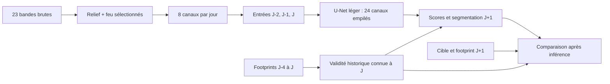
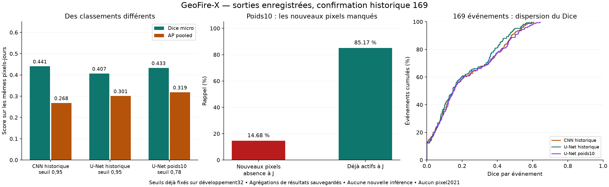

# GeoFire-X — audit scientifique et progression Deep Learning

Audit du 13 novembre 2026, après fusion de la PR #3 (`8c939f6`), sur `feature/scientific-improvements-v1`.

## Décision proposée

**La première expérience pertinente est une seule nouvelle branche Focal Loss sur le U-Net léger T=3, avec les huit canaux et les mêmes exemples que le modèle principal.** Le contrôle est constitué des résultats immuables du poids10 déjà entraîné ; aucune ancienne expérience n'est relancée. Le nouveau run devra repartir de l'initialisation seed42, et non du checkpoint entraîné. Il restera une expérience de recherche tant que les critères préenregistrés ne sont pas satisfaits.

Le protocole est préparé, **pas exécutable en l'état** : il faut encore valider une implémentation de Focal, reproduire l'environnement historique, vérifier l'initialisation et l'ordre des batches, puis autoriser un budget GPU et une destination de sauvegarde. Aucun lanceur d'entraînement n'est ajouté. Le Prediction Studio conserve son modèle et son seuil.

L'ordre conseillé est **A loss → B temporalité → C modalités causales → D ResNet18-U-Net → E U-TAE**, avec décision explicite à chaque étape. A et B utilisent le compact existant ; C ne peut pas récupérer de la végétation ou de la météo à partir des huit canaux déjà stockés. Il n'est pas proposé de reconstruire ce qui fonctionne.

| Nature du constat | Établi ou à vérifier | Conséquence |
|---|---|---|
| Correct et conservé | Compact train/val, normalisation train-only, masques alignés, résultats verrouillés | Réutiliser ces fondations |
| Défaut documentaire prouvé | Bug de vent attribué au mauvais champ ; VNP13A1 décrit localement comme8jours | Corriger l'interprétation dans cet audit, sans changer les données |
| Faiblesse technique prouvée | Le garde actuel accepte une déclaration de disponibilité opaque | Revue exhaustive par asset avant toute extension |
| Limite mesurée | Rappel nouveaux pixels14,68 %, forte dispersion par événement, Brier au-dessus de la constante train | Évaluer plusieurs objectifs et les deux sous-domaines |
| Limite de preuve | Une seed, développement32 réutilisé, confirmation169 consultée | Pas de supériorité statistique ni nouveau test aveugle revendiqués |
| Risque non démontré dans le baseline | Latences/composites/consolidations de variables exclues | Les garder bloquées ; ne pas affirmer une fuite des huit canaux actuels |
| Hypothèses expérimentales | Bénéfice de Focal, d'un historique plus long, de nouvelles modalités ou architectures | Une seule différence à la fois ; aucun gain annoncé avant mesure |

## Périmètre et preuves

L'audit lit le code réel et des JSON/CSV déjà enregistrés, dont les membres JSON du ZIP de calibration. Il ne décode aucun GeoTIFF/NPZ réel, n'infère aucun modèle et ne recalcule aucune AP depuis des probabilités. Les statistiques nouvelles ci-dessous sont des **agrégations arithmétiques de métriques/comptages sauvegardés**, pas de nouveaux scores de modèle.

Références locales principales :

- [23 bandes réelles](../src/geofirex/real_constants.py), [Normalizer](../src/geofirex/unet_data.py), [lectures et masques](../src/geofirex/runner_data.py), [profils](../src/geofirex/feature_profiles.py).
- [Production du compact](../src/geofirex/mission_streaming.py), [loader et sampler utilisés](../src/geofirex/fast_compact.py), [architectures](../src/geofirex/benchmark_models.py), [loss](../src/geofirex/unet.py), [ablation indépendante exécutée](../src/geofirex/loss_ablation.py).
- [Résultat final de confirmation](../reports/unet_confirmation_20261112_v1/RESULTATS_CONFIRMES.md), [comparaison sauvegardée](../reports/unet_confirmation_20261112_v1/confirmation_cpu/comparison.json), [partition nouveaux/anciens pixels](../reports/unet_confirmation_20261112_v1/confirmation_cpu/new_fire.json).
- [Audit produit par cette mission](../reports/scientific_improvements_v1/saved_metrics_audit.json), [507 lignes événement/modèle](../reports/scientific_improvements_v1/per_event_saved.csv), [matrice des 23 variables](../reports/scientific_improvements_v1/feature_availability_matrix.csv), [provenance des sources](../reports/scientific_improvements_v1/sources.json).

### Ce qui est déjà correct

Le compact couvre les 451 événements train/validation, sans pixels 2021 : 250 train (2018–2019), 201 validation (2020), 93 603 tuiles train et 78 771 val. La publication existante répartit les objets en 11 partitions. Les 156 événements 2021 complètent l'inventaire de 607, mais ne sont pas dans ce compact train/validation. Inventorier leur nom et leur volume ne signifie pas en lire les pixels.

Les entrées, cibles et footprints sont alignés temporellement ; le normaliseur est train-only ; les tuiles de validation sont exhaustives ; le sampler actuel conserve chaque tuile une fois par époque. La sélection des poids/seuils est séparée de la confirmation historique. Les empreintes, résultats et API existants restent conservés.

Les anciens fichiers contenant « test » ne désignent pas nécessairement 2021 : le pilote T=1 de cinq événements utilisait `2018/fire_21748813` comme petit test événementiel, selon `reports/unet_baseline_v1_results.json`. Il ne constitue ni une mesure sur le test annuel 2021, ni une comparaison T=1/T=3 valable pour le compact actuel. Ses résultats ne sont pas recyclés pour l'expérience B.

## 1. Des 23 bandes aux huit canaux réellement servis

Les indices ci-dessous sont à la fois **0-based dans NumPy** et **1-based dans GDAL**. `constants.py` décrit l'ancien format synthétique/traité à 40 canaux ; il ne décrit pas la largeur du compact courant. La source de vérité du GeoTIFF réel est `real_constants.RAW_BAND_NAMES`, contrôlée par `validate_layout`.

| Index / bande | Nom dans le GeoTIFF | Famille | Utilisation actuelle |
|---|---|---|---|
| 0 / 1 | M11 | Réflectance VIIRS | Exclue |
| 1 / 2 | I2 | Réflectance VIIRS | Exclue |
| 2 / 3 | I1 | Réflectance VIIRS | Exclue |
| 3 / 4 | NDVI_last | Végétation | Exclue |
| 4 / 5 | EVI2_last | Végétation | Exclue |
| 5 / 6 | total precipitation | Météo GRIDMET | Exclue |
| 6 / 7 | wind speed | Météo GRIDMET | Exclue |
| 7 / 8 | wind direction | Météo GRIDMET | Exclue |
| 8 / 9 | minimum temperature | Météo GRIDMET | Exclue |
| 9 / 10 | maximum temperature | Météo GRIDMET | Exclue |
| 10 / 11 | energy release component | GRIDMET / indice ERC | Exclue |
| 11 / 12 | specific humidity | Météo GRIDMET | Exclue |
| 12 / 13 | slope | Relief | z-score + indicateur manquant |
| 13 / 14 | aspect | Relief | sin + cos + indicateur manquant |
| 14 / 15 | elevation | Relief | z-score + indicateur manquant |
| 15 / 16 | pdsi | Sécheresse GRIDMET | Exclue |
| 16 / 17 | LC_Type1 | Couverture du sol catégorielle | Exclue |
| 17 / 18 | total_precipitation_surface_sum | Prévision GFS | Exclue ; variante `_last` reconnue dans les en-têtes |
| 18 / 19 | forecast wind speed | Prévision GFS | Exclue |
| 19 / 20 | forecast wind direction | Prévision GFS | Exclue |
| 20 / 21 | forecast temperature | Prévision GFS | Exclue |
| 21 / 22 | forecast specific humidity | Prévision GFS | Exclue |
| 22 / 23 | active fire | Détection VIIRS | Binarisation en feu actif |

Le chemin conservateur de `runner_data._read_selected` ne lit que les bandes GDAL `[13,14,15,23]`. `_raw` reconstruit un conteneur de 23 positions avec NaN aux autres positions ; cela **n'ajoute aucune modalité observée**. `Normalizer.transform` construit ensuite exactement :

| Canal final | Calcul | Valeur manquante |
|---|---|---|
| 0 `slope_z` | `(slope − moyenne_train) / écart_type_train`, borné à ±8 | Remplacement par la moyenne, donc z=0 |
| 1 `elevation_z` | Même traitement | z=0 |
| 2 `slope_missing` | 1 si pente non finie | Explicite, distinct de pente moyenne |
| 3 `elevation_missing` | 1 si altitude non finie | Explicite |
| 4 `aspect_sin` | `sin(aspect × π/180)` | 0 |
| 5 `aspect_cos` | `cos(aspect × π/180)` | 0 |
| 6 `aspect_missing` | 1 si aspect non fini ou hors [0,360] | 1 |
| 7 `fire_J` / `active_fire` | `~isnan(raw[22])` | NaN signifie absence de détection, pas automatiquement pixel invalide |

Les codes VIIRS finis, y compris zéro, indiquent une détection ; leur magnitude n'est pas une intensité. Les valeurs infinies sont refusées au bord de lecture. Dans un tenseur temporel, le canal appelé historiquement `fire_J` est le feu **du jour correspondant à chaque frame** : J−2, J−1 ou J, pas trois copies du feu à J.

Le normaliseur certifié comporte 4 948 chemins d'entrée train uniques, exclusivement 2018/2019. Moyennes pente/altitude : 6,7637156601 et 1 535,3911188349 ; écarts-types : 6,7896037299 et 774,4477277411. Il n'est ni refitté ni changé. Son SHA-256 est `bf8b5adb6276126540786351e66076d35c2e82be09b21e14bea96a4c678b2f27`. Les statistiques de relief sont pondérées par les pixels des scènes train utilisées, avec répétition du relief statique entre dates ; ce choix est documenté, sans fuite de validation.

### Profils disponibles dans le code, distincts des données disponibles

| Profil existant | Variables continues brutes | Encodage produit | État réel |
|---|---|---|---|
| `conservative_fire_terrain` | `[12,14]` | 2 z + 2 missing + 3 aspect + 1 feu = **8** | Compact et Studio actuels |
| `terrain_vegetation_v1` | `[0,1,2,3,4,12,14]` + LC | 7 z + 7 missing + 3 aspect + 1 feu + 17 classes LC + 1 unknown = **36** | Schéma prévu, bloqué sans preuve temporelle |
| `multimodal_observed_j_v1` | `[0,1,2,3,4,5,6,8,9,10,11,12,14,15]` + LC | 14 z + 14 missing + 3 aspect + 1 feu + 18 LC = **50** | Schéma prévu, bloqué sans preuve temporelle |

Les indices angulaires 7/19 et les cinq bandes GFS sont exclus de ces profils. LC n'est pas traité comme un nombre continu : une classe entière 1–17 active son one-hot, sinon le canal unknown ; les classes fractionnaires éventuellement issues du rééchantillonnage ne sont jamais arrondies arbitrairement. Les autres continues utilisent z + indicateur manquant, si un profil est un jour validé.

GeoFire-X est donc déjà multimodal **relief + feu**, mais il ne faut pas le présenter comme exploitant actuellement la végétation, le vent ou l'humidité. Les schémas 36/50 ne sont ni des entraînements réalisés, ni des canaux récupérables depuis le compact à huit canaux.

## 2. Disponibilité temporelle : date d'observation ≠ date utilisable

Le cadre actuel est une expérience historique **conditionnelle aux données quotidiennes attribuées à J**, avec coupure logique fin de J en UTC. La livraison opérationnelle du feu de J avant cette coupure n'est pas démontrée ; le Studio n'est pas un service d'alerte temps réel. Pour une extension, il faut distinguer acquisition/début-fin de composite, émission/validité d'une prévision et publication effective du produit.

Le code amont consulté utilise 00:00–23:59 du même jour. Les appels et agrégations observés dans [DatasetPrepareService](https://github.com/SebastianGer/WildfireSpreadTSCreateDataset/blob/master/DataPreparation/DatasetPrepareService.py) et [FirePred](https://github.com/SebastianGer/WildfireSpreadTSCreateDataset/blob/master/DataPreparation/satellites/FirePred.py) expliquent la sémantique attendue, **sans certifier la version exacte ayant généré l'archive 2023 ni sa latence historique**.

| Variables | Date/période observée ou valide | Disponibilité effective à J et décision |
|---|---|---|
| M11, I2, I1 | Observations journalières VIIRS, médiane des observations filtrées | Acquisition le jour J ne prouve pas traitement/publication avant fin J. Demander IDs d'assets, version, acquisition et date de mise à disposition. **Bloquées.** |
| NDVI_last, EVI2_last | Dernier composite sélectionné par timestamp ; VNP13A1 est un produit **16 jours** | Un timestamp de début et un `last` sur une fenêtre ne prouvent pas que toutes les acquisitions du composite soient antérieures à J, ni que le produit ait été publié. **Bloquées.** Le commentaire local « 8-day » doit être considéré obsolète. Le [guide VIIRS](https://lpdaac.usgs.gov/documents/1372/VNP13_User_Guide_ATBD_V2.1.2.pdf) distingue période d'acquisition et date de traitement. |
| Précipitation, vitesse du vent, température min/max, humidité spécifique, ERC | Champs quotidiens GRIDMET attribués au jour | Produits reconstruits/consolidés, pas prévisions émises à J. Le [catalogue GRIDMET](https://developers.google.com/earth-engine/datasets/catalog/IDAHO_EPSCOR_GRIDMET) distingue early, provisional puis permanent après environ deux mois. La vintage de l'archive et sa publication à J ne sont pas identifiées. **Toutes bloquées**, même avec une date nominale ≤J. |
| Direction du vent observée | Champ GRIDMET `th`, même calendrier | Même problème de disponibilité, et nécessité d'encodage circulaire. Exclue ; ne pas invoquer un bug `atan` démontré sur cette bande, voir ci-dessous. |
| PDSI | Indice multi-jours ; sélection d'un intervalle contenant J | Contenir J n'implique ni fin de période ≤J, ni émission à J. Demander vintage, borne de fin et publication ; [produit GRIDMET DROUGHT](https://developers.google.com/earth-engine/datasets/catalog/GRIDMET_DROUGHT). **Bloqué.** |
| Pente, aspect, altitude | Relief statique dérivé de SRTM | Source statique ancienne, déjà retenue dans le baseline historique. Ne pas extrapoler cette justification à des variables annuelles ou météo. Aucun changement. |
| LC_Type1 | Classification annuelle, sélection de l'année civile de J | Une carte consolidée sur l'année peut utiliser des observations après J et être publiée après cette année. Un produit antérieur effectivement disponible pourrait être causal, mais il faudrait l'identifier et le relier aux pixels. Le [catalogue MCD12Q1](https://developers.google.com/earth-engine/datasets/catalog/MODIS_061_MCD12Q1) décrit bien un produit annuel. **Bloqué.** |
| Précipitation GFS | Cycle 00 UTC et échéances 01–24 de la date portée par le fichier, agrégées | Ces bandes ne sont pas automatiquement une prévision de J+1. Exiger cycle, valid-time, lead-time et publication avant la décision. La sémantique pluie sum/last change dans le code amont autour du 7 novembre 2019 ; la tolérance de nom du loader ne convertit aucune valeur. **Bloquée.** |
| Vent GFS (vitesse/direction), température GFS, humidité GFS | Même cycle et mêmes échéances, moyennes ; vent dérivé de u/v | Les TIFF locaux ne portent pas les métadonnées d'émission/livraison nécessaires. Une véritable prévision peut avoir une validité après J si elle est émise **et disponible** avant la décision ; il faut le prouver, pas lire une observation future. Le [catalogue GFS](https://developers.google.com/earth-engine/datasets/catalog/NOAA_GFS0P25) distingue creation_time et forecast_time. **Toutes bloquées.** |
| Feu actif | Acquisitions du jour, agrégées dans le raster quotidien | Détection, pas surface brûlée cumulée ni preuve d'absence physique de feu quand aucune détection. Hypothèse historique existante, pas latence opérationnelle démontrée. La cible J+1 reste séparée. |

La matrice CSV jointe donne une ligne pour chacune des 23 bandes. Le traitement des valeurs manquantes ne rend jamais causale une variable publiée après J : une imputation ne répare pas une fuite temporelle.

### Direction du vent : justification locale à corriger dans la documentation scientifique

Le commentaire de `feature_profiles.py` parle d'un bug de direction **observée**. Le [correctif officiel décrit par l'auteur](https://github.com/SebastianGer/WildfireSpreadTSCreateDataset#updates) et le code examiné concernent en réalité la conversion u/v de la direction **prévue GFS**, indice 19. Le champ observé, indice 7, est lu directement depuis GRIDMET `th`.

Un ancien `atan(v/u)` perd le quadrant ; le correctif emploie `atan2(v,u)`. Cela ne permet pas de reconstruire les quadrants perdus d'anciens fichiers à partir du seul angle. Les deux directions restent exclues : causalité non validée, provenance du calcul à établir et encodage circulaire dédié absent des profils. **Aucun défaut de quadrant des valeurs du champ GRIDMET observé n'est prouvé ici.** Il n'y a pas de nouvelle correction appliquée aux rasters ou aux modèles.

### Garde actuel et validation préparée

Le garde existant exige `reviewed=true`, un champ evidence non vide et une liste de bandes disponibles. Un test synthétique montre qu'une déclaration opaque auto-rédigée suffit à le satisfaire : c'est une **faiblesse du contrôle de preuve**, pas une fuite démontrée du modèle courant. Celui-ci n'utilise aucune extension.

Le nouveau module isolé `experiment_readiness.py` exige, pour une revue future : couverture exhaustive des clés événement/J/date/bande, version et ID de chaque asset, référence et empreinte de preuve, timestamps UTC, fin d'acquisition/composite, publication, et émission pour une prévision. La décision est fixée à fin J ; une date de disponibilité ultérieure, un composite futur ou une couverture incomplète sont refusés. Les deux directions sont refusées tant qu'un encodage/protocole spécifique n'est pas audité.

Ce validateur **ne vérifie pas la vérité d'un document externe et n'active aucun profil**. Une revue humaine et la vérification des artefacts sources restent nécessaires. Aucune déclaration réelle d'extension n'est approuvée dans cette mission.

## 3. Contrat temporel, masques et labels



- `FastCompactTiles` empile les dates cible−3, cible−2, cible−1, soit J−2/J−1/J. `StackedUNet` aplatit T et C : c'est une **fusion précoce de 24 canaux**, pas un réseau récurrent ni une attention temporelle.
- Le relief étant statique, l'essentiel de la variation temporelle actuelle vient de la séquence de détections actives. Un éventuel bénéfice de T=3 ne prouverait pas l'utilisation de météo ou de végétation temporelle.
- Le domaine d'entraînement/évaluation est l'intersection du footprint de la cible et des **cinq** jours historiques J−4…J, plus exclusion du padding. Cette règle donne le même domaine admissible à T=1/T=3/T=5. Les deux jours supplémentaires ne sont pas des entrées supplémentaires du modèle T=3.
- La validité vient des masques GDAL dataset/alpha explicites, du nodata fini de la bande feu et du padding. Un NaN de détection signifie absence de détection ; un NaN de pente/altitude signifie donnée manquante encodée. Ce sont trois notions distinctes.
- Pendant l'inférence Studio, seuls les footprints connus J−4…J sont utilisés. La lecture du footprint cible est interdite avant la réponse de prédiction ; elle intervient dans la requête séparée de vérité terrain pour comparer sur l'intersection.
- Label principal : feu actif binaire à J+1. Nouveaux pixels : `valid & (feu_J == 0) & (cible_J+1 == 1)`. Le sous-domaine candidat est `valid & (feu_J == 0)` ; l'autre est `valid & (feu_J == 1)`. Ils partitionnent exactement les comptages globaux.
- Une nouvelle détection ne prouve ni ignition, ni vitesse de propagation, ni nouvelle surface brûlée. Cette tâche est conditionnelle à un événement/crop historique connu, pas une détection universelle de départs de feu. Le compact servi sans CRS ne justifie aucune surface en hectares.

## 4. Analyse des performances sauvegardées



Figure dérivée uniquement des tables sauvegardées : mêmes169 événements, seuils historiques propres aux modèles. Les barres de rappel concernent le poids10 ; la courbe cumulée donne le même poids à chaque événement.

### Même domaine des 169 événements, seuils propres et déjà fixés

Toutes les lignes suivantes couvrent 65 012 tuiles, 217 506 967 pixels-jours valides et 562 953 positifs. Les comptages sont vérifiés par événement et globalement ; aucune prédiction n'est recalculée.

| Modèle | Seuil | Dice micro | IoU | Précision | Rappel | AP pooled | Brier ↓ |
|---|---:|---:|---:|---:|---:|---:|---:|
| CNN historique B1 | 0,95 | 0,440879 | 0,282774 | 0,359088 | 0,570920 | 0,268377 | 0,00569349 |
| U-Net historique B2 | 0,95 | 0,406695 | 0,255252 | 0,323257 | 0,548191 | 0,300972 | 0,00951151 |
| U-Net poids10 principal | 0,78 | 0,433182 | 0,276473 | 0,404808 | 0,465835 | 0,318618 | 0,00349779 |

| Modèle | TP | FP | FN | Prédits positifs / positifs observés |
|---|---:|---:|---:|---:|
| CNN historique | 321 401 | 573 648 | 241 552 | 1,5899 |
| U-Net historique | 308 606 | 646 071 | 254 347 | 1,6958 |
| U-Net poids10 | 262 243 | 385 578 | 300 710 | 1,1508 |

Le poids10 réduit les FP et améliore l'AP et le Brier par rapport aux deux historiques, mais son Dice reste inférieur au CNN et son rappel inférieur aux deux. Les seuils et poids diffèrent : cette comparaison décrit des points de fonctionnement, elle n'isole pas à elle seule un mécanisme causal de loss.

Le ratio de comptages vaut `(TP+FP)/(TP+FN) = rappel/précision`. Il décrit un biais de volume de pixels-jours, **pas des hectares**. Un ratio proche de 1 ne prouve pas une bonne localisation. Le poids10 conserve 59,52 % de FP parmi ses prédictions positives, alors que son FPR `FP/(FP+TN)` n'est que 0,1777 %. Confondre ces deux dénominateurs serait trompeur dans ce corpus déséquilibré.

Prévalence train enregistrée : 0,130419 % ; prévalence du panel : 0,258821 %. Le Brier d'une constante égale à la prévalence train vaut 0,00258316 sur ce panel, contre 0,00349779 pour le poids10. Son meilleur Brier parmi les trois réseaux **ne prouve donc pas une bonne calibration probabiliste**. La prédiction toujours zéro obtient 0,00258821, sans détecter aucun feu. AP et Brier ne changent pas lorsqu'on modifie seulement le seuil de segmentation.

### Nouveaux pixels et pixels déjà actifs

| Sous-domaine du poids10, seuil 0,78 | Positifs cibles | TP | FP | FN | Dice | Précision | Rappel |
|---|---:|---:|---:|---:|---:|---:|---:|
| Pas de détection à J | 308 168 | 45 245 | 143 828 | 262 923 | 0,181984 | 0,239299 | **0,146819** |
| Déjà détecté à J | 254 785 | 216 998 | 241 750 | 37 787 | 0,608235 | 0,473022 | **0,851691** |

Les nouveaux pixels représentent 54,74 % des positifs cibles. Le modèle manque 85,32 % de ces nouvelles détections à son point de fonctionnement. Leur ratio prédits/observés vaut seulement **0,6135**, alors que le ratio global dépasse 1 : la sur-prédiction globale et la sous-détection des nouveaux pixels coexistent.

Le rappel nouveaux pixels était 22,67 % pour le CNN et 26,21 % pour l'U-Net historiques. Aucune AP/Brier spécifique à ce sous-domaine n'est reconstruite : les sorties retenues fournissent ces métriques globalement et par événement, tandis que la partition temporelle fournit les métriques de segmentation et les comptages. Une AP de sous-domaine demanderait un futur calcul distinct autorisé.

La tête spécialisée de propagation a été entraînée et évaluée auparavant sur le développement32, puis non retenue. Ses résultats agrégés n'incluent pas toutes les courbes, sorties par événement ou cartes du nouveau modèle ; l'optimum de son seuil ne peut pas être revérifié ici. Ne pas promouvoir cette tête ni inventer les preuves absentes.

### Moyennes par événement : autre question que le pooled

| Modèle | Dice macro événement | Médiane Dice | AP macro événement | AP définie |
|---|---:|---:|---:|---:|
| CNN historique | 0,213258 | 0,150418 | 0,118300 | 165 / 169 |
| U-Net historique | 0,202157 | 0,146982 | 0,159903 | 165 / 169 |
| U-Net poids10 | **0,217320** | 0,148710 | **0,160935** | 165 / 169 |

Pour le candidat, les quantiles 10/90 du Dice sont 0 / 0,501135 ; 22 événements ont Dice=0. Quatre événements ne contiennent aucun positif cible : rappel et AP y sont indéfinis et restent exclus des moyennes concernées, avec compte défini explicite. Les conventions de Dice/IoU empty-empty=1 sont conservées.

Sur les mêmes événements, le poids10 améliore le Dice par rapport au CNN sur 92 événements, le dégrade sur 56 et égale sur 21 ; par rapport à l'ancien U-Net : 105 / 43 / 21. Pour l'AP, il améliore 97 des 165 événements définis face à l'ancien U-Net, contre 68 dégradés. Le gain moyen d'AP par événement est beaucoup plus faible que le gain pooled : les deux agrégations ne doivent pas être interchangées.

Les dix événements concentrant le plus de FN représentent 50,72 % des FN du candidat ; les trois premiers sont `2020/fire_24332628`, `2020/fire_24332939`, `2020/fire_24462263`. Ce classement mesure une contribution absolue, pas une difficulté indépendante de la taille. Il sert au diagnostic des sorties déjà consultées, pas à sélectionner de nouveaux cas avantageux.

Les comptages micro agrègent des pixels **et des dates**, donc donnent davantage de poids aux événements grands/longs. La moyenne macro donne un poids égal à chaque événement après agrégation de ses fenêtres. L'AP pooled exacte provient du tri global des scores avec gestion des ex aequo ; elle n'est pas la moyenne des AP événementielles. Dice et IoU ne constituent pas deux preuves indépendantes : `IoU = Dice / (2 − Dice)`.

### Limites de sélection et de confirmation

Sur les 32, l'ablation U-Net sauvegardée donne :

| Poids positif | Seuil choisi | Dice micro | AP |
|---|---:|---:|---:|
| 100 | 0,96 | 0,382562 | 0,259647 |
| 30 | 0,88 | 0,386417 | **0,269986** |
| 10 | 0,78 | **0,387282** | 0,267884 |

Le poids10 gagne seulement 0,000865 de Dice face au poids30 ; une seed ne démontre pas une supériorité robuste. Les 32 ont déjà servi au développement, y compris à plusieurs décisions ; les réutiliser ne crée pas une nouvelle validation indépendante.

La confirmation169 a été réalisée après verrouillage du candidat, mais est désormais consultée. Elle doit rester descriptive pour les expériences futures : pas de sélection de loss, de seuil ou d'architecture sur ses performances. Les nouvelles conditions d'acceptation sont des choix de recherche inspirés du diagnostic connu ; elles ne rétablissent pas un test aveugle. Le test annuel 2021 reste verrouillé et n'est pas utilisé ici.

La confirmation du candidat utilise PyTorch 2.15 CPU, tandis que l'entraînement indépendant utilisait PyTorch 2.11 CUDA. Les domaines sont identiques, mais une identité matérielle des calculs n'est pas revendiquée. Les nouvelles comparaisons de développement devront figer l'environnement et documenter la tolérance numérique avant consultation des résultats.

## 5. Références externes : idées pertinentes, scores non transférables

Le [benchmark officiel WildfireSpreadTS](https://github.com/SebastianGer/WildfireSpreadTS) fournit un protocole annuel à 12 plis. GeoFire-X utilise actuellement **un seul** partage 2018–2019 / 2020 / 2021, et seulement les 169 déjà observés pour cette table. Ce n'est pas une moyenne de douze tests annuels.

[WSTS+ — article, version v3](https://arxiv.org/html/2502.12003v3) motive l'examen de Focal, du préentraînement ImageNet, de ResNet18-U-Net et d'une sélection par AP. Il distingue l'évaluation WSTS à 12 plis et le WSTS+ étendu à quatre blocs biannuels de 2016–2023. Les AP publiées sont agrégées entre plis et jeux de variables Veg/Multi/All. Ni ces agrégations, ni les entrées, crops, budgets et traitements ne sont notre macro par événement ou notre AP pooled sur169. Leurs scores ne servent pas de cible chiffrée directement comparable pour GeoFire-X.

[WildfireSpreadBench, prépublication v2](https://arxiv.org/html/2609.22191v2) justifie de rapporter AP et métriques au seuil avec un ratio de comptages. Son protocole pool les pixels du test2021, utilise le seuil0,5 et une AP approximée sur 200 seuils. Il diffère de notre AP exacte et de nos seuils choisis sur32 ; aucune comparaison directe de ses scores avec nos169 n'est faite. Ses « 23 canaux » de données ne doivent pas être pris pour le nombre final de canaux après encodage.

La [Focal Loss originale](https://arxiv.org/abs/1708.02002) réduit le poids des exemples faciles ; elle n'établit aucun gain mesuré pour GeoFire-X. Les conventions d'alpha, poids de classe, réduction et mélange avec Dice varient selon les implémentations : ne pas copier un scalaire d'un article sans sa définition.

### Poids publics : risque de chevauchement avec 2021

La [fiche officielle des poids WSTS+](https://huggingface.co/saadlahrichi/WSTSPlus) expose des poids par pli et leurs AP de test dans les noms. Dans les 12 partages WSTS, une année intervient dans l'entraînement de six plis, la validation de trois et le test de trois. Un fichier « fold_X » n'est donc pas automatiquement compatible avec le verrou GeoFire-X.

Avant tout import : prouver les années/événements de train, validation, préentraînement et choix d'hyperparamètres, les doublons éventuels et le critère de sélection du fichier. Exclure tout entraînement/tuning sur 2021 ou provenance insuffisante. Même un poids sans gradients sur2021 peut avoir été sélectionné à partir de son AP test. Aucun poids public ni nouveau dataset n'a été téléchargé. Un préentraînement ImageNet générique serait un facteur distinct, avec corpus/version et adaptation d'entrée documentés.

## 6. Expériences indépendantes, courtes et mesurables

Le [contrat JSON préparé](../configs/scientific_improvements_v1.json) contient les valeurs et les blocages. Il n'est consommé par aucun trainer/serveur. Toutes les entrées d'expérience sont `PREPARED_NOT_EXECUTABLE`, `launch_enabled=false`, sans promotion Studio.

### Conditions communes

- Train 2018–2019, mêmes 250 événements et 93 603 tuiles par époque ; développement32 fixe et confirmation169 descriptive ; aucun pixel2021.
- Seed42, quatre époques, batch16, 5 851 updates/époque soit 23 404 updates ; dernier batch de trois tuiles. Pas d'augmentation ni d'équilibrage ajouté. Même LocalitySampler seed42 et même ordre par époque.
- AdamW lr=0,001, weight_decay=0,0001, clipping gradient=1 ; checkpoint comparé à epoch4, sans sélection opportuniste d'époque. Les runs indépendants repartent de zéro, jamais d'une autre variante entraînée.
- Conserver le normaliseur et les archives certifiés. Une éventuelle extension de modalités aurait un normaliseur **nouveau**, fit exclusivement train, séparé et hashé ; aucun fit dans cette mission.
- Seuil sélectionné uniquement sur32 : grille déjà définie par `loss_ablation.THRESHOLDS`, Dice micro maximal, puis précision, puis seuil supérieur. Si optimum en bord de grille, résultat inconclusif ; aucune extension guidée par169.
- Rapporter AP pooled, Dice/IoU, précision/rappel, Brier, FP/FN, deux sous-domaines temporels, macro événement et dispersion. Ne pas modifier les probabilités pour améliorer artificiellement le Brier.
- Seed42 est exploratoire. Une suite43/44 ne serait préparée qu'après un résultat prometteur, avec comparateurs appariés et nouveau budget, sans prétention de significativité à partir d'un run.

### A — changer seulement la famille de loss, priorité1

Référence : sorties existantes du U-Net poids10, `0,5 × BCEWithLogits(pos_weight10) + 0,5 × Dice` par image. Candidat proposé : **Focal binaire seule**, gamma2, poids positif10 et poids négatif1, moyenne sur les pixels valides. Les données, modèle et T=3 restent identiques.

Définition pour un logit z, p=sigmoid(z), label y :

`FL = 10·y·(1−p)^2·softplus(−z) + (1−y)·p^2·softplus(z)`.

Cette convention équivaut à alpha=10/11 multiplié par11. À gamma0 elle retrouve exactement la BCE pondérée10 ; elle évite une différence cachée d'échelle due à alpha. La définition est testée sur quelques tenseurs synthétiques, y compris masques et logits extrêmes, **mais n'est pas encore intégrée à un trainer**.

Cette comparaison isole un changement de **famille de loss**, y compris le retrait de Dice ; elle n'isole pas le seul facteur de focalisation. Si une explication mécanistique devient nécessaire, proposer séparément Focal+Dice gamma2 contre la même combinaison gamma0, avec coefficients et poids inchangés. Ce contrôle optionnel n'appartient pas au premier run proposé.

La référence historique n'est ni réentraînée ni réévaluée. Avant le nouveau run : vérifier la même initialisation `a8353835…c6f5f`, environnement PyTorch2.11.0+cu130, source/optimiseur/sampler et SHA des données. Si l'environnement apparié ne peut pas être établi, l'interprétation causale est bloquée ; ne pas transformer une comparaison technique disparate en preuve de loss.

### B — T=1 contre T=3, priorité2

Employer la loss historique fixe ; ne pas combiner ce facteur avec le traitement A. T=1 prend uniquement J dans les mêmes références compactes. Il conserve les mêmes cibles, événements, tuiles et masques T=5+cible ; aucune reconstruction des jours n'est nécessaire.

Le U-Net natif T=1 possède 122 825 paramètres contre 123 977 à T=3, du fait de la première convolution. Il faut déclarer cette différence : ses tenseurs initiaux ne peuvent pas tous avoir le même hash que T=3. Un contrôle d'information optionnel, distinct, donnerait au même réseau24-canaux trois copies de J au lieu de J−2/J−1/J. Il conserve la capacité mais n'est pas un nouveau signal temporel.

Le petit U-Net T=1 du pilote de cinq événements ne couvre ni ce train ni cette validation ; ses résultats historiques ne répondent pas à la question B.

### C — modalités disponibles à J, priorité3 mais actuellement bloquée

Comparer feu+terrain, puis végétation prouvée causale, puis météo prouvée causale, en gardant loss et T fixes. Le profil végétation existant ajoute aussi LC annuelle : il ne constitue donc pas une ablation pure de végétation. Une décomposition devrait séparer réflectance, indices et couverture du sol, après preuve individuelle.

Le compact8 ne contient pas ces valeurs. Si les conditions de disponibilité sont un jour satisfaites, préférer un overlay immuable lié aux mêmes clés/tuiles, sans remplacer le compact certifié. Aucun overlay, normaliseur, dataset ou partition n'est construit/publié maintenant. Les entrées36/50 multiplieraient le volume d'entrée par4,5/6,25 à T identique ; ces ratios ne sont **pas** des prédictions de durée GPU.

### D — ResNet18-U-Net, priorité4 conditionnelle

Après clarification de la loss et de la temporalité, architecture seule, mêmes données et protocole. Déclarer séparément le préentraînement, l'adaptation des convolutions à la largeur choisie et les versions des bibliothèques. Les quelque14,3M paramètres du modèle de référence externe ne sont pas les123 977 du U-Net actuel ; un rapport de paramètres n'est pas un rapport de temps ou de mémoire.

Il faut d'abord un budget et une qualification de mémoire/temps spécifique lors d'une mission ultérieure autorisée. Aucun package ni poids n'est installé ici.

### E — U-TAE, priorité5 conditionnelle

Exiger un bénéfice de l'historique sur les mêmes cibles, puis une faisabilité GPU. Employer des positions relatives aux vraies dates, conserver le domaine admissible et isoler l'architecture des autres changements. L'existence du prototype ConvLSTM B3 ne prouve ni un résultat U-TAE ni sa faisabilité à grande échelle. Aucun U-TAE n'est préparé comme run actif.

### Critères d'acceptation à figer avant exécution

Proposition de garde pour le candidat au seuil choisi sur32, comparé à la référence sur les mêmes pixels : **toutes** les conditions doivent être satisfaites : AP pooled +0,005 au moins ; Dice micro pas en dessous de−0,005 ; rappel nouveaux pixels +0,02 au moins (deux points) ; FP nouveaux pixels ≤1,15 fois la référence ; Dice macro événement pas en dessous de−0,01. Un optimum de seuil en bord de grille rend la conclusion inconclusive.

Ces valeurs sont des **choix d'ingénierie préenregistrés**, pas des gains attendus, pas des intervalles de confiance et pas une preuve de significativité. Elles ne doivent pas être ajustées après lecture du candidat. Une réussite sur ce développement réutilisé justifie seulement la suite du programme ; elle ne suffit pas à une promotion automatique du Studio ni à une annonce de généralisation.

## 7. Coût GPU : mesures réelles et estimations séparées

La preuve locale exploitable est l'expérience de tête spécialisée déjà terminée : **887,069 s sur Tesla T4**, quatre époques et23 404 updates, PyTorch2.11.0+cu130. Elle partage le compact et le cœur U-Net T3, mais possède une tête/loss supplémentaire ; ce n'est pas une mesure du Focal proposé. Source : `artifacts/propagation-comparison/comparison.json`, relié à `training_complete.json` par le script historique d'intégration. Cela correspond à26,38 updates/s et422,08 présentations de tuile/s sur ce run complet.

| Expérience future | Valeur scientifique | Coût proposé, pas mesuré | Faisabilité actuelle |
|---|---|---|---|
| A, une nouvelle loss | Élevée : compromis FP/FN et classement, facteur isolé de données/architecture | Scénario11,1–22,2 min GPU pour un run4-époques | Compact prêt ; implémentation Focal/env/budget à valider |
| B, une nouvelle branche T1 | Élevée : utilité réelle de l'historique | Même scénario11,1–22,2 min ; vitesse nativeT1 non mesurée | Projection sans reconstruction démontrée sur fixtures ; intégration exhaustive à vérifier |
| C, modalités | Élevée pour le multimodal, conditionnée par causalité | Non estimable honnêtement avant preuve des assets et qualification de l'overlay/loader | Bloquée |
| D, ResNet18-U-Net | Potentiel après baselines | Non mesuré pour GeoFire-X ; qualification spécifique indispensable | Conditionnelle |
| E, U-TAE | Conditionnée par bénéfice temporel | Non mesuré ; dépend de T, résolution, batch et attention | Différée |

La plage de planification A/B applique **des facteurs choisis0,75–1,5** à la mesure de14,78min ; ce n'est ni un intervalle statistique ni une borne garantie. A+B représenteraient0,37–0,74h de nouveau GPU dans ce scénario, hors installation, contrôles d'intégrité, sélection/AP exacte, sauvegarde et seeds/contrôles optionnels. Les temps réels peuvent sortir de cette plage. La confirmation169 historique a pris747,955s **CPU**, pas du GPU.

Ne pas extrapoler971 tuiles/s depuis quatre batches en cache chaud, ni confondre la limite5400s d'un ancien script avec un temps mesuré, ni appliquer les temps d'une publication à notre matériel. Aucun profil GPU, nouveau forward GPU ou quota Kaggle n'a été consommé pendant cet audit.

## 8. Checkpoints et reproductibilité avant le premier lancement

Le futur dossier de run doit être nouveau et hors corpus immuable. Conserver périodiquement et à chaque époque : poids, optimiseur, epoch/update/cursor, RNG Python/NumPy/Torch/CUDA, état ou règle exacte sampler/loader, spécification complète de loss, architecture, versions et empreintes sources/données/normaliseur. La reprise doit refuser un autre traitement ou une autre identité de données.

Conserver séparément un checkpoint de reprise et le checkpoint d'epoch4 destiné à la comparaison. Le rapport ne remplace pas le binaire : sauvegarder le checkpoint hors GitHub, avec manifeste SHA-256 et taille, journal/config, destination de copie explicitement approuvée et contrôle du hash après copie. Aucune copie externe n'est effectuée ici. Ne jamais remplacer l'archive ou le checkpoint principal du Studio.

Avant lancement A, il reste donc à établir : implémentation réelle et tests de réduction/masques ; environnement historique reproductible ; hash initial apparié ; ordre et budget des batches ; espace scratch pour AP exacte ; artefacts source/data figés ; budget GPU accepté ; destination/restauration des nouveaux checkpoints. Les preuves de disponibilité des modalités ne sont pas nécessaires pour A/B sur le baseline historique, mais sont obligatoires avant C et avant toute revendication opérationnelle.

## 9. Livrables et validation de cette mission

Les ajouts comprennent un contrat JSON de préparation, un module de validation isolé, un script d'audit en lecture seule, des tests synthétiques et ce rapport. Une correction de fixture est détaillée ci-dessous. Aucun appel de ces ajouts n'est relié au Studio ou aux trainers existants.

Le script `scripts/audit_scientific_improvements.py` refuse d'écraser ses sorties et peut être relancé vers **un nouveau répertoire** :

```powershell
.\.venv\Scripts\python.exe scripts/audit_scientific_improvements.py --out reports/scientific_improvements_review_next
```

Il lit uniquement les sorties enregistrées et métadonnées ; cette commande ne lance aucune expérience. Les fichiers `saved_metrics_audit.json`, `per_event_saved.csv`, `feature_availability_matrix.csv`, `readiness.json`, `gpu_budget_scenarios.json` et `sources.json` documentent les calculs, blocages et preuves. La validation finale et les empreintes de préservation sont dans `reports/scientific_improvements_v1/VALIDATION.md` et `preservation_after.json`.

Une correction d'une ligne concerne aussi le **fixture** de `tests/test_unet_data.py` : le manifeste synthétique fixe désormais explicitement `root=tmp_path`, comme le lecteur du même test. Sans cela, un répertoire temporaire situé dans le dépôt produisait un chemin relatif au dépôt puis résolu depuis le répertoire temporaire, donc doublé. Cette erreur de fixture n'établit aucun défaut de calcul du normaliseur certifié ; aucun code de production n'est corrigé.

**Aucune amélioration non mesurée n'est annoncée.** Le travail correct est conservé ; les erreurs documentaires, lacunes de garde de disponibilité et limites scientifiques établies sont distinguées des hypothèses à expérimenter. Aucun commit, push, merge, reset ou clean n'a été effectué.
