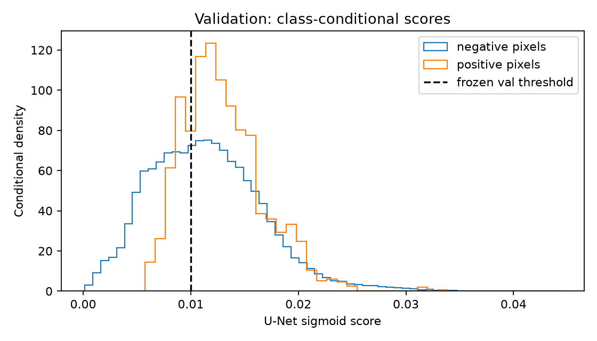

# Audit vérifié de la première U-Net — mission benchmark

Audit du 30 octobre 2026. Checkpoint historique
`artifacts/unet/20261030T091804Z_3277e4f4/best.pt`, run
`77c1d8876ff44e4c9a03f01bb3298fb3`. Les fichiers demandés ont été relus et les
hashes du run vérifiés de nouveau. Les résultats historiques restent conservés.
Les nouveaux diagnostics n'emploient que la validation ; aucun poids n'est mis
à jour et aucun run MLflow d'entraînement n'est créé.

## Ce qui est établi par l'exécution

L'architecture est une véritable U-Net avec 122 825 paramètres. Ses 44 tenseurs
de paramètres ont changé par rapport à la même initialisation ; les étapes
encodeur/bottleneck/décodeur/tête sont toutes concernées. Le mini-overfit réel
avait atteint Dice=0,975 sur une tuile de 316 pixels positifs. Cela prouve une
capacité de mémorisation locale et le fonctionnement des gradients, pas la
convergence ou la généralisation de l'entraînement principal.

| Point audité | Constat vérifié | Implication et limite |
| --- | --- | --- |
| X/Y et dates | T=1 ; J/J+1 consécutifs ; feu à la bande 23 ; cible lue dans le fichier suivant | Pas de cible directement injectée dans X |
| Contrat | X historique `[T,23,H,W]`, entrée U-Net `[B,8,64,64]`, sortie `[B,1,64,64]` | 8 canaux transformés, pas 23 variables explicatives |
| Normalisation | 67 chemins d'entrée train uniques ; valeurs finies ; ni cible seule ni val/test dans les statistiques | Pas de fuite de normalisation constatée ; pondération par pixels/observations, pas par événement |
| NaN | Continus imputés à la moyenne train, indicateurs séparés ; feu NaN→absence de détection | L'absence de détection n'est pas une vérité terrain physique parfaite |
| Canaux | Feu J, pente, exposition sin/cos, altitude et indicateurs de manque | Baseline conservatrice à covariables limitées ; leur responsabilité dans l'échec n'a pas été isolée |
| LC_Type1 | One-hot optionnel 17 classes + inconnu, désactivé | Pas de traitement ordinal ; pas d'hypothèse implicite sur une carte annuelle disponible à J |
| Prévisions et angles | GFS exclu ; exposition encodée sin ET cos ; seul alias pluie sum/last toléré | Ne reproduit pas un modèle toutes modalités des auteurs |
| Loss/optimizer | 0,5 BCE + 0,5 soft Dice ; AdamW lr=0,001, pos_weight=1 ; 80 mises à jour | Pas de recherche de LR, loss ou pondération réalisée ; aucun LR « incorrect » démontré |
| Patches | 50 % de tuiles à cible positive, tirage supervisé limité au train | Ce quota ne signifie ni 50 % de pixels positifs ni couverture uniforme des événements |
| Seuil | 0,01 choisi sur Dice micro validation, borne basse de la grille | Aucun réglage test ; seuil peu satisfaisant, sans pouvoir améliorer le classement AP |
| Checkpoint | Epoch 5, minimum de loss validation exhaustive | Critère valide mais différent de l'AP principale souhaitée pour le futur benchmark |
| Comparaison | Mêmes 23 observations validation et mêmes pixels pour les deux modèles | Appariement exact du run T=1 ; il ne suffit pas pour comparer à T=3/5 sans restreindre les dates |

La provenance de disponibilité des bandes est décrite dans
[le protocole historique](../docs/UNET_BASELINE.md). Le code de création des
bandes est distinct du DataLoader : la correction amont de direction du vent
ne doit pas être confondue avec l'ajout de cosinus lors du prétraitement.

## Échantillonnage réellement reconstruit

La seed, l'epoch et l'index ont permis de reconstruire les 640 tirages des cinq
epochs : **381 tuiles distinctes sur 1 695**, dont **94 positives sur 98**.
Les 640 patches contiennent 8 689 pixels feu sur 2 373 822 pixels valides,
soit **0,3660 % de pixels positifs** malgré le quota positif/négatif 50/50.
Le tirage augmente bien la prévalence par rapport au train naturel (0,0336 %),
mais ne supprime pas le déséquilibre au niveau pixel.

Répartition des tirages : 2018/fire_21997864=279,
2019/fire_23300839=177, 2020/fire_23654679=184. Il s'agit d'un tirage de tuiles,
pas d'une pondération uniforme des événements. Le niveau de couverture et le
petit nombre de mises à jour sont établis ; leur contribution causale exacte
aux mauvaises métriques n'est pas identifiée.

## Loss : mesure, pas diagnostic supposé

Sur les 690 tuiles de validation, les moyennes non pondérées par surface sont :
BCE=**0,013006**, soft Dice loss=**0,999627**. Une moyenne simple donne environ
0,506316 ; elle n'est pas exactement la loss d'epoch 0,506831, car celle-ci
agrège la BCE par batch avec pondération des pixels valides, puis les batches
par nombre de tuiles. Le nombre de pixels valides diffère sur les bords.
Ce détail de réduction est documenté pour éviter de comparer deux moyennes
différentes comme si elles étaient identiques.

Sur une tuile train vide, au checkpoint figé : BCE=0,013215, Dice loss≈1,
norme du gradient par rapport aux logits BCE=2,293×10⁻⁴,
Dice=3,194×10⁻¹⁰. Pour une cible vide, le terme soft Dice utilisé est presque
constant tant que des scores non nuls subsistent. Sur la tuile positive de
316 pixels, les normes sont respectivement 0,004177 et 0,003514.

Cela démontre la faiblesse du signal Dice sur cet exemple vide. Cela ne démontre
pas que changer la loss suffirait à apprendre la propagation. La loss historique
n'a pas été changée rétrospectivement ; une ablation future BCE, BCE pondérée,
BCE+Dice doit être déclarée et sélectionnée sur validation AP.

## Scores, faux positifs et calibration

Validation entière : 2 331 303 pixels, 1 634 positifs (0,07009 %).
Scores U-Net : min=0,0001555 ; p10=0,005143 ; médiane=0,011125 ;
p90=0,017981 ; p99=0,027045 ; max=0,044360.
Aucun pixel n'atteint 0,05. À 0,5 le masque est donc vide ; à 0,01,
**58,28 %** des pixels sont prédits positifs : TP=1 274, FP=1 357 318, FN=360.

La borne basse de seuil n'est pas une explication suffisante de l'échec : l'AP
sans seuil reste très faible. AP U-Net=0,0008373, contre prévalence=0,0007009
pour un score constant sur ce domaine ; Persistence atteint AP=0,2539108.

Dans la tranche de scores [0,01;0,02[, la moyenne prédite vaut 0,013935 et la
fréquence de feu observée 0,000974, soit un écart d'environ un facteur 14.
Le Brier U-Net vaut 0,00084187, contre 0,00070040 pour la constante égale à la
prévalence de validation. Cette constante est une référence diagnostique
rétrospective, pas une baseline apprise sur train.

Ces mesures montrent une mauvaise calibration sur cette validation. Elles ne
distinguent pas les effets du suréchantillonnage, de la loss, du manque de mises
à jour ou du décalage entre événements. Aucun calibrateur n'a été ajusté.

## Sensibilité du modèle figé et protocole spatial

Aucune variante ci-dessous n'est un nouveau modèle entraîné. Le seuil historique
reste fixé ; les mêmes 23 cibles de validation sont utilisées.

| Inférence / ablation | AP micro | Dice micro | FP | FN |
| --- | ---: | ---: | ---: | ---: |
| U-Net historique, tuiles 64 | 0,0008373 | 0,0018732 | 1 357 318 | 360 |
| Canal feu J mis à zéro | 0,0005619 | 0,0010565 | 1 356 834 | 916 |
| Canal feu J décalé de 64 px | 0,0005619 | 0,0010573 | 1 355 790 | 916 |
| Scène entière en un forward | 0,0006224 | 0,0012666 | 1 598 431 | 620 |
| Origine des tuiles décalée de 32 px | 0,0005341 | 0,0010547 | 1 224 572 | 987 |

Retirer ou déplacer le feu dégrade les résultats : le modèle **utilise** ce
canal. La grande majorité des pixels ne change pas quand on le retire, mais
le changement maximal de score atteint 0,01135. L'affirmation « le modèle
ignore complètement le feu » serait donc fausse.

Le forward scène entière et les tuiles diffèrent d'une médiane absolue de
0,002187, p99=0,01413. La moyenne de score est 0,01533 près des frontières de
tuiles contre 0,01094 à l'intérieur. Le contexte convolutif, le padding et les
statistiques spatiales GroupNorm changent avec le découpage. Les mesures
démontrent une sensibilité au protocole ; elles n'isolent pas chacun de ces
mécanismes. Passer aux scènes entières **ne corrige pas** ce checkpoint.
Une future comparaison devra fixer ce choix avant les évaluations.

## Nouveaux pixels et fenêtres vides

816 pixels cibles validation étaient sans détection à J. L'U-Net en rappelle
527 et en manque 289 ; Persistence n'en rappelle aucun par définition.
Sur le domaine candidat des pixels non en feu à J, AP U-Net=0,0003351 et
AP Persistence constante=0,0003503. Le rappel U-Net ne constitue donc pas à lui
seul une amélioration de détection des nouvelles ignitions.

Le calcul exact d'AP sur disque, avec regroupement global des égalités, a été
comparé aux scores sklearn historiques : accord à 10⁻¹². Il évite de confondre
AP globale et moyenne des AP par fenêtre. Les conventions des cibles vides
restent explicites : AP/Recall indéfinies, Dice/IoU=1 si les deux masques sont
vides, Precision indéfinie sans prédiction positive.

## Fuites et conclusions autorisées

Aucune fuite directe X/Y, d'événement ou de statistiques n'a été trouvée dans
ce run. L'audit des fichiers et tests vérifie les contrats examinés ; il ne
prouve pas l'indépendance géographique de tous les événements. Les régions ont
été sélectionnées rétrospectivement et le test historique a déjà été consulté.
Il ne doit pas être réutilisé pour régler les futurs hyperparamètres.

Causes ou défauts **démontrés** : déséquilibre pixel persistant, faible couverture
des tuiles négatives, très mauvais classement, mauvaise calibration observée,
beaucoup de FP au seuil choisi, sensibilité au découpage, divergence entre
critère de checkpoint et métrique principale envisagée.

Hypothèses **non confirmées** : budget d'optimisation insuffisant comme cause
principale, LR inadapté, manque de météo/LC comme cause dominante, architecture
trop petite, amélioration garantie avec ConvLSTM. Aucun de ces diagnostics ne
doit être présenté comme démontré sans ablation ou courbe expérimentale dédiée.

Petite correction apportée au scoring : rejeter les probabilités hors [0,1],
les labels non binaires/NaN, les formes différentes et les noms de prédicteur
inconnus. Les résultats valides du run historique sont reproduits à l'identique.
Ni loss, poids, normalisation, seuil historique ni anciennes expériences MLflow
n'ont été modifiés.

Preuves : [diagnostics complets](unet_diagnostics_v2/diagnostics.json),
[vérification initiale](unet_baseline_v1_verification.json),
`artifacts/benchmark_ap_reference_v1/verification.json` et
`artifacts/unet_mission_benchmark_reverification.json`.
