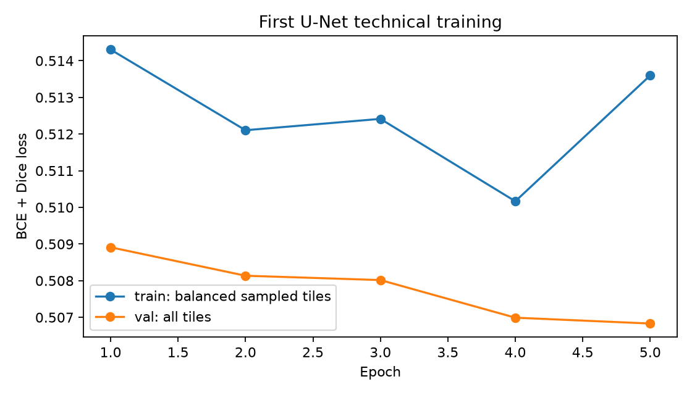
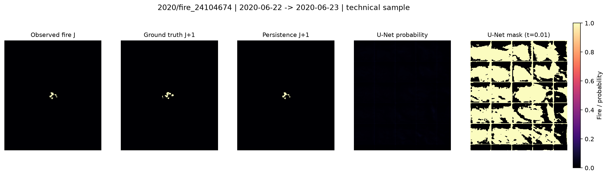
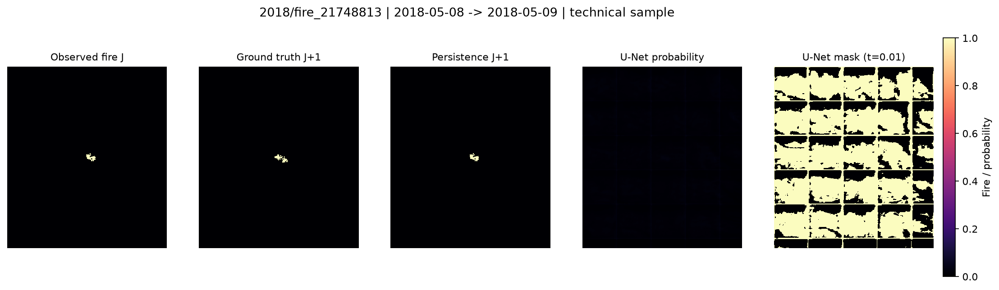

# GeoFire-X — Suivi 3 : premier entraînement U-Net réel

Exécution du 30 octobre 2026, vers 10h18 (Africa/Tunis). Préparation du suivi du
4 novembre. Branche `feature/unet-baseline`, commit de base
`620f8a13500a4d2053f02ef03a479b2c47bf3fa8`. Les ajouts restent non commités.

## Résultat et portée

Une véritable U-Net 2D a été entraînée sur les GeoTIFF WildfireSpreadTS locaux,
avec gradients, mises à jour des poids, validation, checkpoint sélectionné,
évaluation appariée et suivi MLflow. Le mini-overfit réel réussit. **Le modèle
appris après ce premier budget court échoue sur le plan prédictif et reste très
inférieur à Persistence.** Ce résultat négatif est conservé intégralement.

Il ne s'agit pas d'un benchmark scientifique : 5 événements seulement, avec
1 événement de validation et 1 événement de test. Aucune performance OOD ou
supériorité du Deep Learning n'est démontrée.

## Audit préalable et architecture

Les 60 tests historiques ont réussi avant tout ajout. Les 108 GeoTIFF ont été
relus : 23 bandes, aucune valeur infinie, dimensions variables par événement,
grilles cohérentes J/J+1, aucun rejet de fenêtre. La bande feu est la 23e ; son
masque est `~isnan`, la cible provient exclusivement du lendemain.

L'audit a découvert deux noms pour la bande GFS de pluie : `..._sum` (56 fichiers)
et `..._last` (52). Le nouveau lecteur contrôle les descriptions et accepte ce
seul alias à la bonne position. Les données et constantes historiques restent
inchangées. Pente/exposition ont 2,36 % de pixels manquants et altitude 2,33 %.

Les bandes retenues sont le feu à J, la pente, l'altitude et l'exposition. Après
normalisation et ajout des indicateurs de manque/sin/cos : **8 canaux**.
Les moyennes et écarts-types sont calculés uniquement sur les 67 chemins
d'entrée uniques du train, avant tout échantillonnage. Moyenne/écart-type :
pente 6,27541 / 5,69317 ; altitude 1 411,41587 / 807,35930.

LC_Type1 est traité par un encodeur optionnel 17 classes + inconnu, jamais comme
une variable continue. Il reste exclu du run : sa carte annuelle n'est pas
assurée disponible à J. Les observations/composites/météo dont la livraison
n'est pas vérifiée sont aussi exclus. La décision et les sources scientifiques
sont détaillées dans [le protocole audité](../docs/UNET_BASELINE.md).

Architecture : trois encodeurs à deux convolutions 3×3, largeurs 8/16/32,
max-pooling ; bottleneck à 64 ; décodeurs avec interpolation bilinéaire,
concaténation des skips et convolutions ; GroupNorm/ReLU ; tête 1×1 à un logit.
Sigmoid à l'inférence. **122 825 paramètres** ; CPU et CUDA pris en charge par
le code. La MX550 2 Go est visible par `nvidia-smi`, mais le venv contient
`torch 2.15.0+cpu`, `torch.version.cuda=None`, CUDA indisponible. Run sur CPU,
Python 3.11.6, 2 threads ; aucune installation CUDA effectuée.

## Données et séparation

Le split historique `splits/real/smoke_test_split.csv` est réutilisé sans écriture.

| Split | Événements | Fenêtres T=1 | Pixels cibles | Pixels feu | Prévalence | Cibles vides |
| --- | --- | ---: | ---: | ---: | ---: | ---: |
| Train | 2018/fire_21997864, 2019/fire_23300839, 2020/fire_23654679 | 67 | 5 727 433 | 1 924 | 0,03359 % | 37 |
| Validation | 2020/fire_24104674 | 23 | 2 331 303 | 1 634 | 0,07009 % | 5 |
| Test | 2018/fire_21748813 | 13 | 1 305 018 | 339 | 0,02598 % | 7 |

Chaque événement n'apparaît que dans un split. Les doublons et les chemins
réutilisés sont rejetés. Les NaN des entrées continues sont imputés à la moyenne
train et accompagnés d'un indicateur de manque. Les GeoTIFF restent en lecture
seule ; les SHA256 de chaque fichier sont archivés.

Grille 64×64 sans recouvrement : 98 tuiles positives et 1 597 négatives dans le
train. Chaque epoch tire 64 positives et 64 négatives avec remise. Validation
exhaustive sur 690 tuiles ; évaluation sur les images complètes reconstituées.
Le padding est exclu. Les labels de validation/test ne servent jamais à choisir
des patches d'évaluation.

## Exécutions réellement effectuées

Un premier run de diagnostic a échoué avant l'entraînement principal :
`6759bbb347ab4da1a0c5b8061cb12a97`, statut MLflow **FAILED**. La première tuile
positive ne contenait que 7 pixels feu : après 120 pas, loss 0,522775 → 0,414895,
Dice à 0,5 = 0. Les artefacts et le run échoué sont conservés. Ce résultat n'est
pas présenté comme un entraînement abouti.

Le diagnostic a ensuite utilisé la tuile de train la plus riche en feu :
2018/fire_21997864, cible 2018-08-08, origine (128,128), **316 pixels positifs**.
200 pas Adam à lr=0,01 en 3,87 s : loss **0,623117 → 0,059263**, Dice à 0,5
**0,975000**. Forward `[1,8,64,64] → [1,1,64,64]` et backward finis. Ce modèle
est jeté ; le modèle principal est initialisé de nouveau avec seed=42.

Run principal : AdamW lr=0,001, weight_decay=0,0001 ; loss 0,5 BCEWithLogits +
0,5 soft Dice ; pos_weight=1 ; batch=8 ; 128 patches/epoch ; **5 epochs et
80 mises à jour**. Environ **98,10 s** pour les epochs ; **148,01 s** pour audit,
préparation, diagnostic, entraînement et évaluation jusqu'à l'écriture des
résultats (hors copie finale des artefacts MLflow).

| Epoch | Loss train | Loss validation exhaustive | Durée (s) |
| ---: | ---: | ---: | ---: |
| 1 | 0,514304 | 0,508911 | 19,90 |
| 2 | 0,512104 | 0,508135 | 19,77 |
| 3 | 0,512414 | 0,508017 | 19,28 |
| 4 | 0,510166 | 0,506991 | 19,83 |
| 5 | 0,513598 | 0,506831 | 19,32 |

Meilleur checkpoint : **epoch 5**, minimum de loss validation. Les pertes train
et validation reflètent des distributions différentes (échantillonnage équilibré
au train, prévalence naturelle en validation). La petite baisse de validation
ne suffit pas à conclure que le feu a été appris.



## Évaluation appariée

Le seuil **0,01** maximise le Dice micro sur la validation parmi les 13 valeurs
préétablies. C'est la borne basse de la grille, signe d'un modèle peu séparant.
À partir de 0,05, aucun pixel n'est prédit positif en validation. Aucun seuil ou
hyperparamètre n'a été choisi à partir des scores test. Le checkpoint et le seuil
étaient figés avant la première inférence test ; aucun autre entraînement n'a
été effectué après consultation des résultats test.

Les deux prédicteurs sont évalués sur exactement les mêmes observations et tous
leurs pixels, sans padding. PR-AUC = Average Precision scikit-learn.

| Split / modèle | Dice micro | IoU micro | Precision micro | Recall micro | PR-AUC micro |
| --- | ---: | ---: | ---: | ---: | ---: |
| Validation / U-Net | 0,001873 | 0,000937 | 0,000938 | 0,779682 | 0,000837 |
| Validation / Persistence | 0,503540 | 0,336487 | 0,506502 | 0,500612 | 0,253911 |
| Test / U-Net | 0,000851 | 0,000426 | 0,000426 | 1,000000 | 0,001728 |
| Test / Persistence | 0,294985 | 0,173010 | 0,294985 | 0,294985 | 0,087199 |

Validation U-Net : TP=1 274, FP=1 357 318, FN=360 ; test : TP=339,
FP=796 015, FN=0. Le rappel élevé résulte d'une prédiction positive sur une grande
partie de l'image (58,3 % des pixels validation, 61,0 % test), et n'indique pas une
prévision exploitable. Persistence reste nettement supérieure sur les métriques
de recouvrement et de classement.

| Split / modèle | Dice macro toutes fenêtres | Dice macro fenêtres positives | PR-AUC macro définie |
| --- | ---: | ---: | ---: |
| Validation / U-Net | 0,001871 | 0,002390 | 0,001373 |
| Validation / Persistence | 0,492791 | 0,407455 | 0,249120 |
| Test / U-Net | 0,000850 | 0,001842 | 0,005595 |
| Test / Persistence | 0,528545 | 0,145180 | 0,063061 |

Sur test, Persistence passe de Dice macro 0,5285 sur toutes les fenêtres à 0,1452
sur celles ayant du feu. Les fenêtres vides expliquent cet écart. PR-AUC est
indéfinie dans 5/23 fenêtres validation et 7/13 test ; elles sont exclues de la
moyenne, avec décompte. Precision sans prédiction et Recall sans cible sont aussi
`null`. Dice/IoU valent 1 lorsque les deux masques sont vides. Les anciennes
conventions des métriques historiques sont préservées dans leur module ; cette
comparaison recalcule les deux modèles avec les mêmes nouvelles conventions.

Les détails par fenêtre et événement, les nombres de métriques définies et les
moyennes par événement sont dans [les résultats complets](unet_baseline_v1_results.json).
Les moyennes par événement coïncident ici avec les moyennes par fenêtre, puisqu'il
n'y a qu'un événement par split évalué.

## Figures du checkpoint réel

Chaque figure montre, dans l'ordre : feu observé à J, cible J+1, Persistence,
probabilités U-Net et masque U-Net au seuil validation. La barre est fixée à
[0,1] ; les probabilités très faibles apparaissent donc sombres. Les raccords
de tuiles sont visibles dans les faux positifs. Aucune correction visuelle des
prédictions n'a été effectuée.





Des exemples sans feu cible sont également conservés :
[validation](figures/unet_baseline_v1/val/window_000.png),
[test](figures/unet_baseline_v1/test/window_000.png).

## MLflow, checkpoint et reproduction

Expérience **`geofirex-unet2d-real-v1`**, ID local 3 ; run abouti
**`77c1d8876ff44e4c9a03f01bb3298fb3`**, statut **FINISHED**.
Les deux runs historiques de Persistence restent présents et FINISHED.

Dossier local : `artifacts/unet/20261030T091804Z_3277e4f4/`.
Checkpoint : `best.pt` (avec poids, optimizer, config, normalisation et seuil).
SHA256 checkpoint :
`127d0112263d803be71509da2f30ff2f602fd0c5a086f345e4e8e79237f24e9e`.
Hash du catalogue des sources du run :
`65c7dcf83a2b921dda28e59ee9fb94ad9a05dc340e755d1026c463ff674e0da7`.

Le run archive configuration, statistiques train, snapshots des sources non
commitées, `pip freeze`, état Git, SHA256 de chaque GeoTIFF/manifeste/split,
losses par epoch, diagnostic réel, checkpoint, grille de seuils, résultats et
figures. Les artefacts MLflow sont sous `mlruns/3/<run_id>/artifacts/`.

Commandes effectivement utilisées :

```powershell
.\.venv\Scripts\python.exe scripts/audit_unet_data.py --out reports/unet_data_audit_v1.json
.\.venv\Scripts\python.exe -u scripts/train_unet.py --config configs/unet_baseline.yaml --device cpu
.\.venv\Scripts\python.exe -m pytest -q
```

L'audit refuse d'écraser son fichier de sortie ; employer un nouveau nom à la
réexécution. L'entraînement crée toujours un dossier/run nouveau.

Pour recalculer les métriques du checkpoint sans réentraîner ni recalibrer :

```powershell
.\.venv\Scripts\python.exe scripts/evaluate_unet.py --checkpoint artifacts/unet/20261030T091804Z_3277e4f4/best.pt --split-name test --expected-results artifacts/unet/20261030T091804Z_3277e4f4/results.json --out artifacts/replay_test_nouveau.json
```

## Vérifications et limites

**84 tests réussis**, soit les 60 historiques et 24 nouveaux, sans skip :
forward/backward, mini-apprentissage sur motif de test, loss BCE/Dice et stabilité,
padding, normalisation sans val/test/cibles seules, one-hot/inconnus, splits,
alignement, DataLoader équilibré, inférence aux bords, checkpoint et GeoTIFF,
conventions des métriques et interdiction de sélectionner le seuil sur test.
Les avertissements proviennent de rasterio/Affine et des rasters factices sans
géoréférence des tests historiques.

Le checkpoint réel est rechargé et les évaluations validation **et** test sont
rejouées, sans optimisation : égalité exacte des métriques avec `results.json`.
L'inférence autonome sur un
GeoTIFF J réel produit deux GeoTIFF géoréférencés (probabilité et masque), sans
accès à J+1. Le [contrôle final](unet_baseline_v1_verification.json) confirme les
hashes des **108 bruts inchangés**, des **51 sources archivées**, la normalisation
train seule, les métriques/checkpoint MLflow et la cohérence de l'inférence réelle.
**44 tenseurs de paramètres ont changé**, dans chacun des étages du modèle,
par rapport à l'initialisation avec la même seed. Le checkpoint pèse 1 525 437
octets avec l'état de l'optimizer. Les probabilités de l'exemple d'inférence vont
de 0,000305 à 0,039708.

Le mini-overfit prouve la capacité à mémoriser une tuile, pas à généraliser.
Avec 80 mises à jour, une extrême rareté des pixels positifs et des covariables
limitées, le modèle reste sous-entraîné ; l'origine exacte de son échec n'est pas
isolée par une ablation. Les tuiles vides et leur Dice doux contribuent fortement
à la loss. Le suréchantillonnage des tuiles ne rééquilibre pas tous leurs pixels
et ne calibre pas les probabilités. La faible loss de validation ne remplace
pas des métriques de feu positives.

Pour la suite, un autre protocole devra être déclaré avant les runs : budget de
mises à jour accru mais borné, pondération des pixels positifs calculée sur train,
comparaison des losses et gestion des raccords, puis ajout de covariables avec
disponibilité temporelle vérifiée. Les choix se feront sur validation. Le test
actuel a été consulté : le réutiliser de manière répétée pour améliorer les
hyperparamètres ne fournirait plus une évaluation finale indépendante.

Aucun GeoTIFF brut, ancien manifeste, split ou ancien run n'a été écrasé. Aucun
téléchargement du dataset complet, aucun frontend/Spark, aucun commit/push et
aucune modification de `main` n'ont été effectués.
