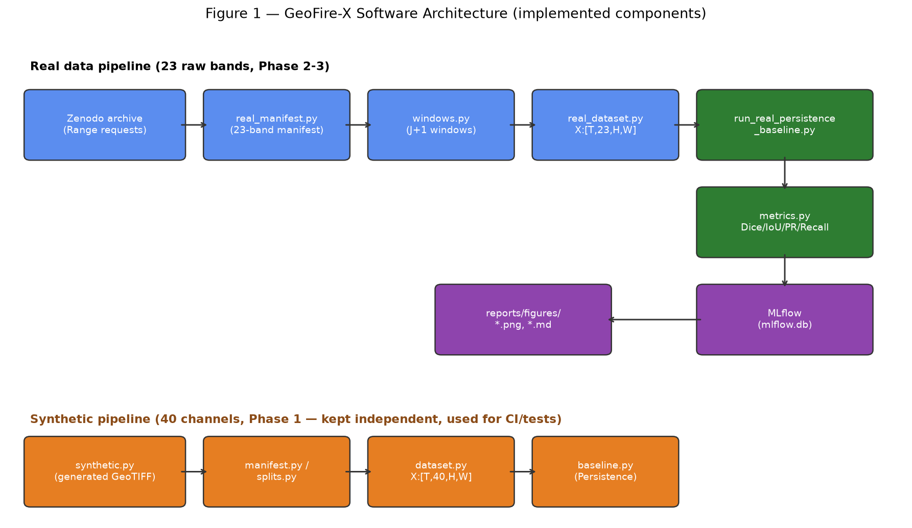

# GeoFire-X — Rapport de deuxième validation

TEK-UP University — Module Projet Big Data et Deep Learning
Équipe : 4 étudiantes ingénieures Data Science / IA
Date : 10 octobre 2026 — Validation prévue le 14 octobre 2026

---

## A. Introduction

### Contexte

GeoFire-X est un projet de recherche sur la prédiction de la propagation des
incendies de forêt au jour suivant (J+1) à partir d'observations
spatio-temporelles multimodales (imagerie satellite, météo, topographie,
occupation du sol). La première validation (état de l'art) a positionné le
projet comme une étude de **fusion multimodale structurée** et de
**modélisation spatio-temporelle explicite sous changement de domaine**
(distribution shift géographique et temporel), plutôt qu'un choix
architectural a priori.

### Problématique

Prédire une carte binaire de feu actif à J+1 à partir d'un historique de T
jours d'observations multimodales, tout en évaluant la robustesse du modèle
face à des changements de géographie, de temporalité ou de source de données.

### Lien avec les questions de recherche

- **RQ1 — Fusion multimodale** : les 23 canaux bruts de WildfireSpreadTS
  (réflectance satellite, végétation, météo, topographie, occupation du sol,
  prévisions) sont désormais lus, documentés et chargés ensemble dans un seul
  tenseur — fondation nécessaire avant toute étude de fusion.
- **RQ2 — Modélisation temporelle explicite** : le DataLoader réel construit
  des fenêtres de contexte configurables (T=1, 2, 3 jours), condition
  préalable à toute comparaison entre un modèle "image unique" et un modèle
  exploitant l'historique temporel.
- **RQ3 — Robustesse géographique et temporelle** : la stratégie de split
  officiellement recommandée (validation croisée par année) est implémentée
  et prête à être appliquée dès que l'échantillon réel sera suffisant ; la
  limite actuelle (5 événements) est documentée explicitement plutôt que
  contournée.

### Objectifs de cette deuxième validation

1. Démontrer un pipeline de bout en bout fonctionnel sur des **données
   réelles** WildfireSpreadTS (pas seulement synthétiques).
2. Produire une baseline simple (Persistence) comme point de comparaison
   scientifique pour les futurs modèles.
3. Documenter honnêtement ce qui est acquis, ce qui est limité par la taille
   de l'échantillon actuel, et ce qui reste à faire.

---

## B. Réalisation depuis la première validation

| Étape | Statut | Référence |
| --- | --- | --- |
| Initialisation du repository (structure, `.gitignore`, licence des données) | Fait | commit `3e3fd28` |
| Architecture Python (`src/geofirex/`, `pyproject.toml`, tests) | Fait | commit `ea18ac6` |
| Pipeline synthétique complet (40 canaux, DataLoader, baseline, MLflow) | Fait, conservé indépendant | `src/geofirex/{synthetic,dataset,baseline}.py` |
| Acquisition ciblée du dataset réel (sans télécharger les 48,36 Go) | Fait | `src/geofirex/remote_archive.py`, `reports/DATA_AUDIT.md` |
| Audit des fichiers GeoTIFF réels (23 bandes, convention Active Fire) | Fait | `reports/DATA_AUDIT.md`, `scripts/audit_real_sample.py` |
| Manifeste réel enrichi | Fait | `data/manifests/real/manifest_wildfirespreadts.csv` |
| DataLoader réel (`X:[T,23,H,W]`, `Y:[1,H,W]`) | Fait | `src/geofirex/real_dataset.py` |
| Construction des fenêtres temporelles J+1 (T=1,2,3) | Fait | `src/geofirex/windows.py` |
| Stratégie de split (CV par année + smoke-test documenté) | Fait, échelle limitée | `src/geofirex/real_splits.py`, `docs/SPLIT_STRATEGY.md` |
| Baseline Persistence réelle | Fait, vérification technique | `scripts/run_real_persistence_baseline.py` |
| Métriques (Dice, IoU, Precision, Recall, PR-AUC, masque, agrégation) | Fait | `src/geofirex/metrics.py` |
| Tests automatisés | Fait | 56/56 tests, voir section F |
| Suivi MLflow | Fait | expérience `geofirex-real-persistence-baseline` |

---

## C. Architecture technique

Le projet est organisé en deux pipelines **volontairement indépendants** :

- Un **pipeline synthétique** (Phase 1, 40 canaux post-prétraitement), utilisé
  pour développer et tester le code sans dépendre du téléchargement réel.
- Un **pipeline réel** (Phases 2-3, 23 bandes brutes), qui lit directement les
  fichiers GeoTIFF officiels.

Ils partagent des briques communes (`metrics.py`, `splits.py`, `io.py`) mais
ne mélangent jamais leurs formats de données — une confusion aurait été une
erreur scientifique grave (voir section H).



Flux du pipeline réel : l'archive Zenodo est interrogée par requêtes HTTP
Range (jamais téléchargée en entier) → `real_manifest.py` construit un
manifeste enrichi par fichier → `windows.py` construit les fenêtres J+1
valides → `real_dataset.py` les charge en tenseurs PyTorch → la baseline
Persistence les évalue avec `metrics.py` → les résultats et figures sont
écrits sur disque et tracés dans MLflow.

---

## D. WildfireSpreadTS

- **Provenance officielle** : Zenodo record 8006177 (DOI
  `10.5281/zenodo.8006177`), auteurs Gerard, Zhao, Sullivan (KTH), licence
  CC-BY-4.0. Code officiel : github.com/SebastianGer/WildfireSpreadTS (licence
  MIT).
- **Version** : v1.0, publiée le 2023-10-25. Taille exacte de l'archive :
  48 359 369 821 octets (48,36 Go), MD5 `dc1a04e63ccc70037b277d585b8fe761`
  — **jamais téléchargée en entier** dans ce projet.
- **Structure réelle, vérifiée** (table centrale du ZIP lue à distance, 1,6 Mo
  transférés) : 607 événements, 13 607 observations journalières — chiffres
  identiques à ceux annoncés dans l'article, confirmés empiriquement, pas
  simplement recopiés.
- **Les 23 bandes** (ordre officiel, vérifié à la fois dans les métadonnées
  GDAL des fichiers réels et dans le datasheet officiel) : réflectance VIIRS
  (M11, I2, I1), indices de végétation (NDVI, EVI2), météo (précipitation,
  vent, températures, humidité, indice de sécheresse, ERC), topographie
  (pente, aspect, élévation), occupation du sol (`LC_Type1`, catégoriel),
  prévisions météo (5 canaux NOAA GFS), et feu actif.
- **Organisation** : `<année>/fire_<id_numérique>/<date_ISO>.tif` — un fichier
  par jour, un dossier par événement.
- **Résolution** : 375 m / pixel, confirmée par la transform GDAL de chaque
  fichier.
- **Difficultés observées** : voir section H.
- **Différence 23 bandes brutes / 40 canaux prétraités** : les fichiers
  GeoTIFF distribués par Zenodo contiennent **23 bandes**. Le chiffre de
  **40 canaux**, que l'on trouve dans le code officiel
  (`FireSpreadDataset.py`), correspond au tenseur produit **après** le
  prétraitement officiel (`CreateHDF5Dataset.py`), qui éclate le canal
  catégoriel `LC_Type1` en 17 canaux one-hot. GeoFire-X **n'a pas encore
  reproduit cette étape** et travaille directement sur les 23 bandes brutes.

---

## E. Pipeline expérimental

```
GeoTIFF (23 bandes, Zenodo)
   │
   ▼
real_manifest.py          → data/manifests/real/manifest_wildfirespreadts.csv
   │  (chemin, dimensions, canaux, CRS, gap de date, par fichier)
   ▼
windows.py                → liste de fenêtres (event_id, dates contexte, date cible)
   │  (T configurable, rejet documenté si trou/forme incohérente)
   ▼
real_dataset.py           → X:[T,23,H,W], Y:[1,H,W] (tenseurs PyTorch)
   │  (NaN géré, Active Fire binarisé par présence, pas par seuil)
   ▼
run_real_persistence_baseline.py
   │  (persistence = dernier jour observé, pas d'entraînement)
   ▼
metrics.py                → Dice, IoU, Precision, Recall, PR-AUC, agrégation
   │
   ▼
reports/*.md, reports/figures/*.png, MLflow (mlflow.db)
```

---

## F. Résultats

### Tests automatisés (réexécutés, pas recopiés)

```
python -m pytest -q
→ 56 passed in ~15-19s (variable selon la machine)
```

### Fenêtres temporelles (réexécuté)

| T (context_days) | Fenêtres créées | Rejets |
| --- | --- | --- |
| 1 | 103 | 0 |
| 2 | 98 | 0 |
| 3 | 93 | 0 |

Aucun trou de date et aucune incohérence de forme détectés sur l'échantillon
réel actuel (5 événements, 108 observations).

### Baseline Persistence — reproduite et vérifiée bit pour bit

```
Split : smoke-test, split_name=train (3 événements), context_days=1
Fenêtres valides : 67
Temps d'exécution : ~12-14 s (deux exécutions indépendantes, mêmes résultats)

Dice:      0.5584
IoU:       0.5201
Precision: 0.6848
Recall:    0.6728
PR-AUC:    0.1247
```

**Méthode d'agrégation — clarification essentielle.** Ces chiffres sont une
**moyenne arithmétique simple sur les 67 fenêtres** ("macro par fenêtre") :
chaque fenêtre contribue à égalité, qu'elle contienne beaucoup ou aucun pixel
de feu. Ce n'est ni une agrégation micro (TP/FP/FN cumulés sur tous les
pixels de toutes les fenêtres avant un seul calcul), ni une moyenne macro par
événement (qui donnerait un poids égal aux 3 événements indépendamment de
leur nombre de fenêtres — cette agrégation existe séparément, voir
`per_event_metrics` dans `reports/real_baseline_results.json`).

**Analyse de robustesse (calcul de vérification, code non modifié).** Sur les
67 fenêtres évaluées : **30 ont une cible ET une prédiction vides** (aucun
pixel de feu, ni observé ni prédit) — par convention mathématique (lissage
epsilon), ces fenêtres reçoivent un Dice = 1.0, ce qui **gonfle** la moyenne
globale. **7 fenêtres** ont une cible vide mais une prédiction non vide (faux
positifs purs, Dice = 0). **30 fenêtres** ont une cible réellement positive —
c'est sur celles-ci que la vraie difficulté de la tâche se révèle :

| Sous-ensemble | n | Dice | IoU | Precision | Recall |
| --- | --- | --- | --- | --- | --- |
| Toutes les fenêtres (chiffre publié) | 67 | 0.558 | 0.520 | 0.685 | 0.673 |
| Fenêtres à cible réellement positive | 30 | **0.247** | **0.162** | 0.529 | **0.269** |

Ce contraste illustre concrètement la limite structurelle de Persistence :
elle ne peut jamais prédire une **nouvelle ignition** (seulement reproduire ce
qui était déjà observé), d'où un recall qui s'effondre dès qu'on se concentre
sur les cas où un événement se produit réellement.

**PR-AUC (0.1247)** n'est calculé que sur les 30 fenêtres à cible positive
(la métrique est mathématiquement indéfinie sans positif — le code retourne
`None`, jamais un 0 fabriqué, et `None` est exclu de la moyenne). Sa valeur
reste peu informative ici car Persistence produit une prédiction déjà binaire
(0/1), pas un score continu — PR-AUC redeviendra pleinement pertinent pour un
futur modèle à sortie probabiliste.

**Mêmes pixels valides, même ensemble d'observations ?** Oui : aucun masque
de validité différentiel n'est appliqué (`mask=None` partout dans ce run),
chaque fenêtre est évaluée sur l'intégralité de son image, et les 67 fenêtres
proviennent exactement et uniquement du split "train" du smoke-test — aucune
exclusion silencieuse.

### Qualification scientifique — à ne jamais oublier

**Ces résultats sont une vérification technique du pipeline sur 3 événements
réels (67 fenêtres), pas un benchmark scientifique.** Le script lui-même
imprime cet avertissement avant d'afficher les métriques. Le seuil retenu
pour une évaluation défendable statistiquement est de 20 événements minimum
(`geofirex.real_splits.MIN_EVENTS_FOR_SCIENTIFIC_SPLIT`) — l'échantillon
actuel (5 événements sur 607) est très en dessous.

---

## G. Qualité et reproductibilité

- **Tests** : 56/56, incluant 2 tests de smoke-test réel avec
  auto-désactivation si l'échantillon réel est absent du disque (jamais
  présent sur un clone frais, car `.gitignore`).
- **Seed** : fixe (42) pour l'échantillonnage des événements et le split
  smoke-test — reproductibilité vérifiée par réexécution.
- **Versions** : dataset v1.0 (DOI cité), split "smoke_test" explicitement
  nommé non-scientifique, commit Git enregistré à chaque run MLflow.
- **Configuration** : `context_days`, `split_name`, seed, chemins — tous
  passés en arguments explicites, aucun état caché.
- **Git** : branche `feature/phase3-real-pipeline`, synchronisée avec
  `origin`, aucune divergence constatée lors de l'audit.
- **MLflow** : 2 runs enregistrés dans `geofirex-real-persistence-baseline`,
  métriques identiques entre les deux exécutions (déterminisme confirmé).
- **Protection des données brutes** : `data/raw/`, `mlflow.db`, `mlruns/`
  restent hors Git (`.gitignore` vérifié) ; aucun chemin absolu personnel
  détecté dans le code.

---

## H. Difficultés et solutions

| Difficulté | Solution apportée |
| --- | --- |
| L'archive officielle fait 48,36 Go — impossible et non autorisé de la télécharger entièrement | Lecture de la table centrale du ZIP par requêtes HTTP Range (1,6 Mo), puis extraction ciblée de 5 événements (441 Mo) sans jamais toucher au reste de l'archive |
| Le serveur Zenodo retournait parfois des 502/504 ou (en théorie) un 200 inattendu au lieu d'un 206 | Validation stricte de chaque réponse Range (statut 206, `Content-Range`, nombre d'octets exact) avant toute lecture du corps — un 200 inattendu est refusé, jamais lu, ce qui empêche structurellement un téléchargement complet accidentel |
| Confusion initiale entre 23 bandes brutes et 40 canaux post-prétraitement | Vérification empirique directe sur les fichiers réels (comptage de bandes avec `rasterio`), documentation explicite de l'écart dans `docs/DATASET_VERSION.md`, constantes séparées (`real_constants.py` vs `constants.py`) pour ne jamais les confondre dans le code |
| La bande "Active Fire" n'est pas un masque binaire 0/1 mais un code de détection VIIRS non-binaire avec ~99,8% de valeurs manquantes par convention | Binarisation systématique par présence de valeur (`~isnan`), jamais par seuil sur la magnitude — conforme au datasheet officiel, vérifié sur fichier réel |
| Déséquilibre extrême des classes (feu actif très rare spatialement) | Documenté quantitativement (Figure 5), `eps` de lissage dans les métriques pour éviter les divisions par zéro, distinction claire entre score global et score sur fenêtres à cible positive (section F) |
| Résumer un échantillon de 5 événements sans sur-interpréter | Qualification systématique "vérification technique sur échantillon" dans le code, les rapports et cette validation — jamais présenté comme une généralisation |

---

## I. Travaux restants

- **Extension du dataset réel** au-delà de 5 événements (cible : ≥20, seuil
  conservateur documenté) pour permettre une évaluation statistiquement
  défendable.
- **Véritable évaluation multi-années** : `split_events_by_year` est
  implémenté et testé, mais nécessite un échantillon étendu pour produire des
  plis représentatifs (2021 n'est pas encore représenté dans l'échantillon
  actuel).
- **Normalisation fit sur train uniquement** : pas encore implémentée — les
  statistiques de normalisation (moyenne/écart-type par canal) devront être
  calculées sur le split train seul et appliquées sans fuite aux splits
  val/test.
- **Encodage de `LC_Type1`** : actuellement une valeur catégorielle brute dans
  le tenseur d'entrée ; à transformer en one-hot ou embedding avant tout
  modèle qui l'exploiterait réellement.
- **U-Net 2D** : baseline de deep learning suivante, non entraînée dans cette
  phase (contrainte explicite de la mission).
- **ConvLSTM** / modélisation temporelle explicite : prévue après le U-Net 2D.
- **Fusion multimodale structurée** (RQ1) : à étudier une fois une baseline de
  deep learning simple en place.
- **Évaluation OOD** (RQ3) : géographique et temporelle, conditionnée par
  l'extension du dataset.
- **Big Data et mise à l'échelle** : traitement distribué de l'extraction et
  du prétraitement pour un passage à l'échelle du corpus complet (607
  événements), non nécessaire tant que l'échantillon de développement reste
  petit.

---

## J. Conclusion

Cette deuxième validation établit une fondation technique vérifiée et
reproductible : un DataLoader réel fonctionnel sur les données officielles
WildfireSpreadTS, une construction de fenêtres temporelles J+1 sans fuite
d'information, un split documenté honnêtement dans ses limites actuelles, des
métriques robustes aux cas dégénérés, et une baseline simple qui fixe un
point de comparaison scientifique pour les futurs modèles. Chaque composant
est testé automatiquement (56/56) et chaque affirmation de ce rapport a été
vérifiée par réexécution, pas simplement recopiée du code. Les prochaines
étapes (extension du dataset, U-Net 2D, ConvLSTM, fusion multimodale,
évaluation OOD) peuvent maintenant s'appuyer sur cette base sans avoir à
revalider les fondations de données.
